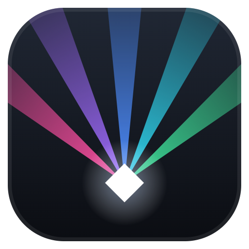

<p align="center"></p>

# Lightshow Studio

3D light-show designer and DMX previsualizer, built for laser shows. Program
a show to a song on a timeline, see it in a hazy 3D venue, and send it to a
real rig over Art-Net / sACN — or let a lighting console drive the 3D view.

> **Working on the code?** Start with [`CLAUDE.md`](CLAUDE.md) and the
> [`Docs/`](Docs/) folder — especially [`Docs/DESIGN_DECISIONS.md`](Docs/DESIGN_DECISIONS.md)
> (the *why* behind the choices) and [`Docs/Roadmap.md`](Docs/Roadmap.md)
> (what's done and where it's going).

## Install

1. Download **`LightshowStudio-Setup-x.y.z.exe`** from the
   [latest release](https://github.com/Royalkiller2222/lightshow-studio/releases/latest).
2. Run it. It installs for your Windows user (no admin needed), adds Start-menu
   and desktop shortcuts, and opens the app.

Windows may say *"Windows protected your PC"* because the installer isn't
code-signed yet — click **More info → Run anyway**. On first launch Windows
Firewall asks about network access: allow it, or no DMX leaves the computer.

## A tour of the window

It opens on a demo show: four moving heads sweeping coloured beams through
haze and a laser drawing a spinning, breathing tunnel. With no song loaded the
16-second demo loops.

- **Top bar** — the show's name, open/save, undo/redo, the **Build** and
  **Program** workspaces, play/stop with the clock and tempo, the
  **Simple / Pro** switch, the output status (click it for Art-Net / sACN
  settings), **Search** (Ctrl+K finds any command) and help.
- **Build workspace** — drag fixtures from the library into the room (they
  land as a mirrored pair across the centre line by default). Click a fixture
  to edit its name, position, facing and DMX address in the inspector on the
  right. The patch sheet along the bottom lists everything.
- **Program workspace** — load a song (its tempo is detected), then drag laser
  patterns and fixture effects from the library onto the timeline's named
  tracks (or below them to start a new track). Click a cue to edit it on the
  right. Laser cues have BEYOND-style Key Effects — size, rotation, position,
  colour, brightness and more — each one keyframeable with the ◆ buttons;
  open a laser track to shape the curves right under the music. Tracks have
  mute / solo; markers (M) name the song's sections; Ctrl+wheel zooms.
- **On the 3D view** — Select / Move / Rotate tools, a camera reset, haze, room
  light and house light, the laser output preview, and "Hold for sparks".
  Left-drag orbits, right-drag pans, scroll zooms.
- **Simple vs Pro** — Simple keeps just the essentials. Pro shows DMX
  addresses and every advanced control (tucked under "More").

Press **?** for all keyboard shortcuts.

## Check the DMX output

Install [QLC+](https://qlcplus.org) (free). With the output set to
`127.0.0.1`, open QLC+'s DMX monitor on Art-Net universe 1 to watch the
channels animate at 40 Hz. Switch the app to *Follows a console* (Pro → output
settings) and QLC+'s faders drive the 3D fixtures instead.

Demo patch (universe 1): moving heads 1–4 at 1 / 10 / 19 / 28 (Pan, Pan fine,
Tilt, Tilt fine, Dimmer, R, G, B, Zoom); the cold-spark pair shares 37
(Trigger > 127 fires, Height). Laser cues are visual-only for now.

## Run from source

1. Install **Node.js LTS** from https://nodejs.org.
2. Double-click **`Start Lightshow.bat`** (first run downloads dependencies),
   or in a terminal: `npm install`, then `npm start`.

`npm test` runs the Art-Net / sACN loopback self-test. `npm run dist` builds
the installer into `dist/`; `npm run icons` regenerates the icons from the
logo in `src/ui/logo.js`.

## Releases

Every finished update becomes a GitHub Release with the installer attached:
bump `version` in `package.json`, add a `## vX.Y.Z` section to
[`CHANGELOG.md`](CHANGELOG.md), commit, then push a tag (`git tag v0.3.0`,
`git push origin v0.3.0`). GitHub Actions builds the installer on Windows and
publishes the release with that changelog section as its notes.

## How it works

The renderer owns the **UniverseHub** — the single source of truth for all DMX
channel state. Writers: the show engine (playing the timeline's cues) in
internal mode, or incoming Art-Net when following a console. Readers: every
fixture (they only know their patch address and react to channel values, like
real fixtures on the wire) and the Electron **main process**, which mirrors the
buffers and sends them on its own steady 40 Hz tick — so a render hitch never
strobes your rig.

```
Show engine (timeline cues)                 External console
            |                                     |
            v                                     v  (Art-Net in, port 6454)
        UniverseHub  <----------------------------
        /         \
       v           v
 3D fixtures    Main process ---> Art-Net / sACN out ---> nodes & rig
```

Beams are analytic fresnel cone shells (no raymarching) with additive blending,
ACES tone mapping and bloom. Cost scales with beam pixels on screen, so dozens
of fixtures run fine on mid-range GPUs.

## Notes

- **Enttec USB Pro** support is deferred: it needs the `serialport` native
  module. Art-Net/sACN covers modern nodes; cheap Art-Net gateways bridge to
  5-pin DMX.
- The installer isn't code-signed (a certificate costs money); that's why
  SmartScreen warns on first run.
